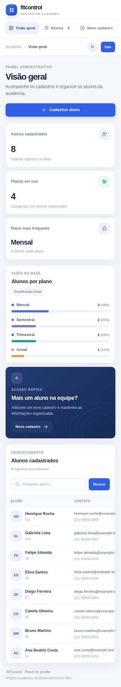
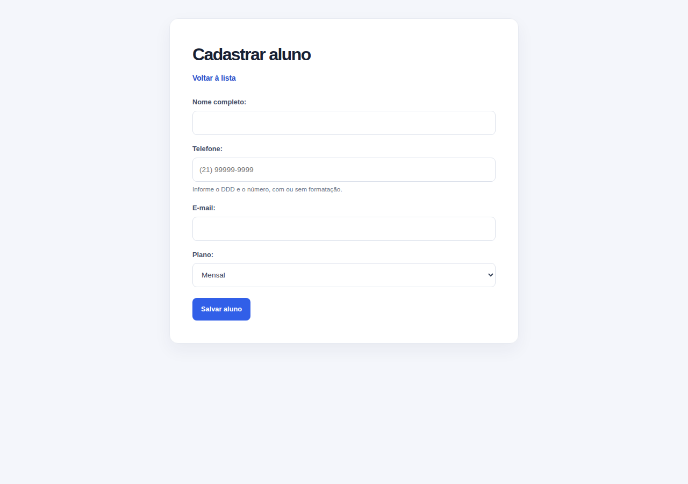

# FitControl — Gestão de alunos de academia

Aplicação acadêmica de Desenvolvimento Web para gerenciar cadastros de alunos de uma academia. O projeto evoluiu de um CRUD em PHP e MySQL para um painel administrativo com indicadores, distribuição de alunos por plano e busca.

## Prévia do projeto

As imagens abaixo são capturadas automaticamente pelo GitHub Actions com registros de demonstração fictícios, preparados apenas no banco efêmero do CI.


<p align="center">
  
  
  
</p>

<p align="center">
  
</p>

> **Escopo atual:** aplicação local/acadêmica. O painel ainda não possui autenticação real nem controle de acesso por usuário; não deve ser publicado como sistema administrativo aberto à internet sem essa camada.

## Funcionalidades

- Dashboard com total de alunos cadastrados.
- Indicador de planos em uso e plano mais frequente.
- Distribuição de alunos por plano.
- Cadastro e edição de alunos.
- Listagem e pesquisa por nome.
- Exclusão com tela de confirmação.
- Validação dos dados no servidor e no navegador, incluindo formato e quantidade de dígitos do telefone.
- Consultas preparadas com PDO.
- Token CSRF nos formulários de escrita.
- Mensagens de retorno e preservação dos dados após erros de validação.
- Layout responsivo para telas menores.
- Preferência entre tema claro e escuro, disponível em Configurações e salva no navegador.

Cada aluno possui nome, telefone, e-mail e plano (Mensal, Trimestral, Semestral ou Anual).

## Tecnologias

- PHP 8.2 ou superior, com PDO.
- MySQL 8 ou MariaDB.
- HTML5, CSS3 e JavaScript.
- GitHub Actions para integração contínua.
- Playwright e Chromium para capturas e verificações visuais automatizadas.
- JavaScript e localStorage para persistência da preferência de tema no navegador.
- Shell script, curl e servidor embutido do PHP para testes de integração.

## Estrutura do projeto

```text
academia-alunos-crud/
├── .github/
│   └── workflows/
│       └── ci.yml
├── docs/
│   ├── relatorio-testes-academia-alunos.md
│   └── screenshots/
│       ├── dashboard-desktop.png
│       ├── dashboard-mobile.png
│       ├── alunos-mobile.png
│       └── cadastro-desktop.png
├── tests/
│   ├── capture-screenshots.mjs
│   └── integration-crud.sh
├── banco.sql
├── conexao.php
├── configuracoes.php
├── funcoes.php
├── index.php
├── cadastro.php
├── salvar.php
├── excluir.php
├── style.css
├── script.js
└── theme.js
```

## Como executar localmente com XAMPP

1. Copie ou clone a pasta do projeto em `C:\\xampp\\htdocs\\academia-alunos-crud`.
2. Inicie Apache e MySQL no painel do XAMPP.
3. Acesse o phpMyAdmin em [http://localhost/phpmyadmin/](http://localhost/phpmyadmin/).
4. Importe o arquivo `banco.sql`. Ele cria o banco `academia_alunos` e a tabela `alunos`.
5. Confira as configurações de conexão em `conexao.php`, caso seu XAMPP utilize host, porta, usuário ou senha diferentes.
6. Acesse [http://localhost/academia-alunos-crud/](http://localhost/academia-alunos-crud/).

### Configuração do banco por variáveis de ambiente

O projeto mantém os padrões comuns do XAMPP (host `127.0.0.1`, porta `3306`, banco `academia_alunos`, usuário `root` e senha vazia), mas permite substituir esses valores por variáveis de ambiente:

| Variável | Padrão local |
|---|---|
| `DB_HOST` | `127.0.0.1` |
| `DB_PORT` | `3306` |
| `DB_NAME` | `academia_alunos` |
| `DB_USER` | `root` |
| `DB_PASSWORD` | vazio |

Não coloque credenciais reais no repositório. Em ambientes compartilhados, configure os valores no ambiente de execução ou nos secrets do provedor.

## Testes automatizados

O workflow [CI - Academia Alunos CRUD](https://github.com/Alex5762/academia-alunos-crud/actions/workflows/ci.yml) é executado em pushes para `main` e `feat/dashboard-portfolio`, além de pull requests destinados a `main`.

O pipeline:

1. prepara PHP 8.2, Node.js 24, MySQL 8 e Chromium;
2. verifica a sintaxe de todos os arquivos PHP;
3. confere a presença dos arquivos essenciais;
4. importa o schema de `banco.sql`;
5. inicia a aplicação com o servidor embutido do PHP;
6. executa `tests/integration-crud.sh` contra os endpoints reais;
7. prepara registros fictícios no banco temporário e captura as telas desktop e mobile com Playwright;
8. disponibiliza as imagens como artefato e, em pushes para a branch de desenvolvimento, atualiza os arquivos versionados em `docs/screenshots/`.

Os testes de integração cobrem:
- rejeição de token CSRF inválido (HTTP 403);
- validação de e-mail e telefone inválidos, com preservação dos dados do formulário;
- cadastro de aluno;
- pesquisa pelo nome;
- edição e conferência da persistência no MySQL;
- abertura da confirmação por GET sem excluir o registro;
- exclusão por POST e verificação da remoção no banco;
- rejeição de método GET no endpoint de gravação (HTTP 405).

A captura visual também verifica a presença dos registros de demonstração, a ausência de rolagem horizontal na página mobile, a rolagem horizontal contida na tabela de alunos e a persistência da preferência de tema escuro entre páginas.

Para conferir os resultados, consulte a aba **Actions** do GitHub. Uma execução verde confirma apenas os cenários incluídos no workflow; não substitui os testes exploratórios em navegadores e dispositivos físicos.

## Documentação

- [Relatório de testes manuais e automatizados](docs/relatorio-testes-academia-alunos.md)
- [Roadmap e critérios de evolução por blocos](docs/roadmap.md)
- [Planejamento do Bloco 01 — autenticação e auditoria](docs/bloco-01-autenticacao.md)
- [Modelo de dados e migração de autenticação/auditoria](docs/modelo-dados-autenticacao-auditoria.md)

## Relação com o material da disciplina

A estrutura PHP partiu do exemplo CRUD de PHP e MySQL do Tutorial 7, adaptando os dados de produtos para alunos. O JavaScript utiliza conceitos básicos de DOM e eventos trabalhados no Tutorial 2.

---

**Projeto:** FitControl — Gestão de alunos de academia  
**Repositório:** [Alex5762/academia-alunos-crud](https://github.com/Alex5762/academia-alunos-crud)
