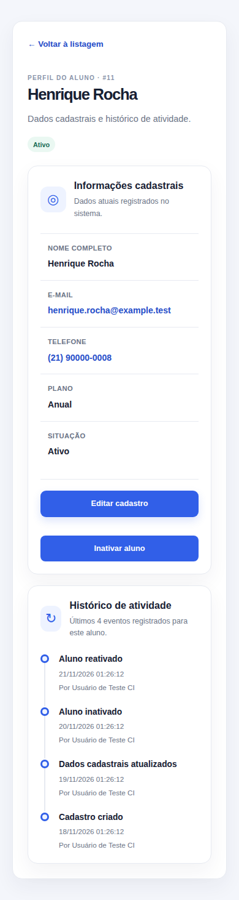
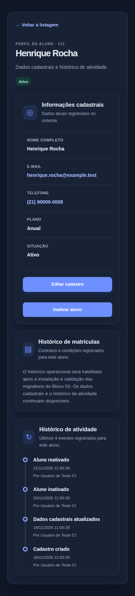
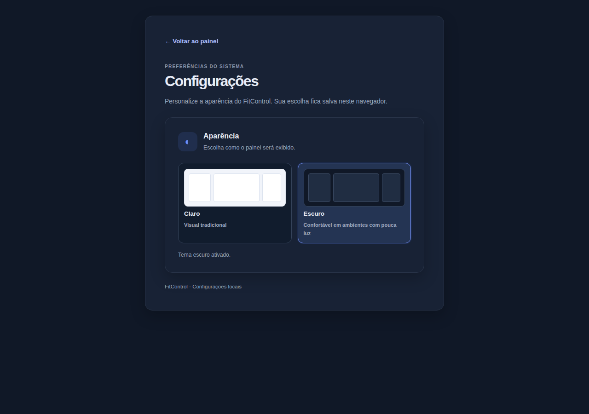
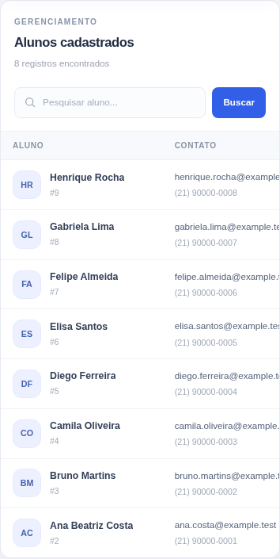

# FitControl — Gestão de alunos de academia

Aplicação acadêmica de Desenvolvimento Web para gerenciar cadastros de alunos de uma academia. O projeto evoluiu de um CRUD em PHP e MySQL para um painel administrativo com indicadores, distribuição de alunos por plano e busca.

## Prévia do projeto

As imagens abaixo são capturadas automaticamente pelo GitHub Actions com registros de demonstração fictícios, preparados apenas no banco efêmero do CI.


### Perfil do aluno — tema claro

<p align="center">
  
  
</p>

### Perfil do aluno — tema escuro

<p align="center">
  
  
</p>

<p align="center">
  
  
  
</p>

<p align="center">
  
</p>

> **Escopo atual:** aplicação acadêmica/local com primeira versão de autenticação individual, gestão de funcionários, auditoria e controle de sessão. Ainda faltam revisão de segurança para produção, HTTPS de produção, monitoramento, backups e controles adicionais. Não exponha o painel à internet nem use dados reais de alunos.

## Funcionalidades

- Dashboard com total de alunos cadastrados.
- Indicador de planos em uso e plano mais frequente.
- Distribuição de alunos por plano.
- Cadastro e edição de alunos.
- Listagem com filtro de ativos/inativos/todos e pesquisa por nome, e-mail ou telefone.
- Inativação e reativação lógica de alunos, preservando os registros e a auditoria.
- Perfil individual do aluno com dados cadastrais, situação e histórico simples de auditoria (criação, edição, inativação e reativação).
- Validação dos dados no servidor e no navegador, incluindo formato e quantidade de dígitos do telefone.
- Consultas preparadas com PDO.
- Token CSRF nos formulários de escrita.
- Mensagens de retorno e preservação dos dados após erros de validação.
- Layout responsivo para telas menores.
- Preferência entre tema claro e escuro, disponível em Configurações e salva no navegador.
- Contas individuais de funcionários, provisionadas pelo terminal (sem cadastro público).
- Gestão de funcionários: criação de contas, listagem, desativação e reativação sem apagar o histórico.
- Senhas temporárias aleatórias exibidas uma única vez, com troca obrigatória no primeiro acesso.
- Proteção contra desativar a própria conta e contra deixar o sistema sem contas ativas.
- Auditoria de criação, desativação e reativação de contas, identificando o funcionário responsável.
- Login e logout com senha armazenada por hash, sessão protegida e CSRF.
- Limitação persistente de tentativas: após 5 falhas na combinação de e-mail e origem em uma janela de 15 minutos, o acesso dessa combinação fica bloqueado por 15 minutos.
- Troca obrigatória da senha temporária no primeiro acesso, com mínimo de 12 caracteres.
- Bloqueio das páginas administrativas para visitantes não autenticados e contas desativadas.
- Expiração após 30 minutos sem interação ou 8 horas desde o login, com aviso antecipado e opção de continuar conectado.
- Sincronização autenticada da sessão enquanto o funcionário interage com a página, sem renovar sessões abandonadas.
- Auditoria de login/logout e das operações de cadastro, edição, inativação e reativação de alunos.

Cada aluno possui nome, telefone, e-mail, plano (Mensal, Trimestral, Semestral ou Anual) e situação ativa/inativa. Registros inativos permanecem consultáveis e editáveis.

## Tecnologias

- PHP 8.2 ou superior, com PDO.
- MySQL 8 ou MariaDB.
- HTML5, CSS3 e JavaScript.
- GitHub Actions para integração contínua.
- Playwright com Chromium, Firefox e WebKit para verificações automatizadas em múltiplos motores de navegador e viewports.
- JavaScript e localStorage para persistência da preferência de tema no navegador.
- Shell script, curl e servidor embutido do PHP para testes de integração.

## Estrutura do projeto

```text
academia-alunos-crud/
├── .github/
│   └── workflows/
│       └── ci.yml
├── docs/
│   ├── relatorio-testes-academia-alunos.md
│   └── screenshots/
│       ├── dashboard-desktop.png
│       ├── dashboard-mobile.png
│       ├── aluno-detalhes-desktop.png
│       ├── aluno-detalhes-mobile.png
│       ├── aluno-detalhes-desktop-escuro.png
│       ├── aluno-detalhes-mobile-escuro.png
│       ├── alunos-mobile.png
│       └── cadastro-desktop.png
├── database/
│   └── migrations/
│       ├── 001_authentication_audit.sql
│       ├── 002_force_password_change.sql
│       ├── 003_login_rate_limit.sql
│       └── 004_student_status.sql
├── tests/
│   ├── browser-compatibility.mjs
│   ├── capture-screenshots.mjs
│   ├── integration-crud.sh
│   └── migration-student-status.sh
├── banco.sql
├── conexao.php
├── configuracoes.php
├── funcoes.php
├── index.php
├── cadastro.php
├── detalhes-aluno.php
├── salvar.php
├── excluir.php
├── style.css
├── script.js
└── theme.js
```

## Como executar localmente com XAMPP

1. Copie ou clone a pasta do projeto em \`C:\\xampp\\htdocs\\academia-alunos-crud\`.
2. Inicie Apache e MySQL no painel do XAMPP.
3. Acesse o phpMyAdmin em [http://localhost/phpmyadmin/](http://localhost/phpmyadmin/).
4. Importe o arquivo \`banco.sql\`. Ele cria o banco \`academia_alunos\` e a tabela \`alunos\`.
5. Confira as configurações de conexão em \`conexao.php\`, caso seu XAMPP utilize host, porta, usuário ou senha diferentes.
6. No banco \`academia_alunos\`, execute pelo phpMyAdmin (aba SQL), nesta ordem:
   - \`database/migrations/001_authentication_audit.sql\`
   - \`database/migrations/002_force_password_change.sql\`
   - \`database/migrations/003_login_rate_limit.sql\`
   - \`database/migrations/004_student_status.sql\`
7. No terminal, a partir da pasta do projeto, execute \`php scripts/provisionar-usuario.php\`, informe nome e e-mail e copie a senha temporária exibida uma única vez. No XAMPP, se necessário, use \`C:\\xampp\\php\\php.exe scripts\\provisionar-usuario.php\`.
8. Acesse [http://localhost/academia-alunos-crud/login.php](http://localhost/academia-alunos-crud/login.php) e entre com a conta criada. Entregue a senha temporária por canal seguro.
9. No primeiro acesso, substitua a senha temporária por uma senha pessoal com pelo menos 12 caracteres.

### Configuração do banco por variáveis de ambiente

O projeto mantém os padrões comuns do XAMPP (host `127.0.0.1`, porta `3306`, banco `academia_alunos`, usuário `root` e senha vazia), mas permite substituir esses valores por variáveis de ambiente:

| Variável | Padrão local |
|---|---|
| `DB_HOST` | `127.0.0.1` |
| `DB_PORT` | `3306` |
| `DB_NAME` | `academia_alunos` |
| `DB_USER` | `root` |
| `DB_PASSWORD` | vazio |

Não coloque credenciais reais no repositório. Em ambientes compartilhados, configure os valores no ambiente de execução ou nos secrets do provedor.

## Testes automatizados

O workflow [CI - Academia Alunos CRUD](https://github.com/Alex5762/academia-alunos-crud/actions/workflows/ci.yml) é executado em pushes para \`main\` e \`feat/dashboard-portfolio\`, além de pull requests destinados a \`main\`.

O pipeline:

1. prepara PHP 8.2, Node.js 24, MySQL 8 e os motores Chromium, Firefox e WebKit;
2. verifica a sintaxe de todos os arquivos PHP e a presença dos arquivos essenciais;
3. importa \`banco.sql\`, executa as migrações 001, 002 e 003 e testa a migração 004 com um aluno legado inserido antes da alteração;
4. provisiona uma conta fictícia e verifica hash, auditoria e unicidade do e-mail;
5. inicia a aplicação com o servidor embutido do PHP e executa os testes HTTP reais;
6. prepara registros fictícios no banco temporário e executa as verificações Playwright;
7. publica as capturas como artefato e, em pushes para a branch de desenvolvimento, atualiza os arquivos versionados em \`docs/screenshots/\`.

Antes dos testes HTTP, `tests/migration-student-status.sh` insere um aluno usando o esquema anterior, executa a migração 004 e confere a preservação do ID e dos dados, o status ativo por padrão, o status de novos registros e o índice composto. O teste HTTP cobre também a mudança transacional de status, proteção CSRF, idempotência e aposentadoria da exclusão física.

Os testes de integração cobrem:

- acesso anônimo, login inválido/válido e rejeição de conta desativada;
- troca obrigatória da senha temporária, rejeição da senha antiga e auditoria;
- limite de tentativas de login e liberação após autenticação válida;
- criação, desativação e reativação de funcionários, incluindo bloqueio de autodesativação;
- cadastro, pesquisa, edição, inativação e reativação de alunos, com persistência no MySQL;
- rejeição do endpoint legado `excluir.php` com HTTP 410, sem remover o registro;
- idempotência da alteração de status, sem duplicação de auditoria em solicitações repetidas;
- associação dos eventos de auditoria ao funcionário autenticado;
- logout, revogação de sessão após desativação de conta e proteção CSRF;
- expiração após 30 minutos de inatividade e após 8 horas de duração absoluta;
- renovação autenticada da sessão, rejeição de CSRF inválido e rejeição de método GET.

A captura visual em Chromium verifica a presença dos registros de demonstração, ausência de rolagem horizontal inesperada no desktop/mobile, rolagem interna da tabela no mobile, navegação mobile por teclado, aplicação e persistência do tema escuro, ausência de erros JavaScript e exibição dos avisos de expiração de sessão. O teste `tests/browser-compatibility.mjs` repete verificações essenciais em Chromium, Firefox e WebKit, em larguras desktop, mobile e mobile estreito, incluindo overflow, rolagem interna, navegação por teclado, foco visível, validação nativa dos campos obrigatórios e persistência do tema.

Para conferir os resultados, consulte a aba **Actions** do GitHub. Uma execução verde confirma apenas os cenários incluídos no workflow; não substitui inspeção visual humana em dispositivos e navegadores reais nem uma revisão independente de segurança.

## Documentação

- [Relatório de testes manuais e automatizados](docs/relatorio-testes-academia-alunos.md)
- [Checklist de validação manual pendente — celular real, navegadores e acessibilidade](docs/checklist-validacao-manual.md)
- [Roadmap e critérios de evolução por blocos](docs/roadmap.md)
- [Planejamento do Bloco 01 — autenticação e auditoria](docs/bloco-01-autenticacao.md)
- [Planejamento do Bloco 02 — gestão de alunos](docs/bloco-02-gestao-alunos.md)
- [Pesquisa e proposta técnica do Bloco 03 — planos e matrículas](docs/bloco-03-planos-matriculas.md)
- [Roadmap e critérios de evolução por blocos](docs/roadmap.md)
- [Modelo de dados e migração de autenticação/auditoria](docs/modelo-dados-autenticacao-auditoria.md)

### Gestão de funcionários

Depois de entrar com uma conta ativa, abra **Funcionários** no menu lateral. Informe nome e e-mail para criar uma conta; o sistema gera uma senha temporária e a mostra uma única vez na tela. Copie-a e entregue ao funcionário por canal seguro. No primeiro acesso, ele deverá definir uma senha pessoal com pelo menos 12 caracteres.

Na lista, é possível desativar e reativar outras contas. A própria conta não pode ser desativada, e o sistema bloqueia a operação que deixaria a base sem contas ativas. Contas inativas não conseguem entrar; o histórico de auditoria permanece associado à conta. Nesta versão, todas as contas ativas têm as mesmas permissões administrativas.

Para alterar sua senha depois do primeiro acesso, abra **Configurações → Segurança da conta → Alterar senha**. O sistema solicita a senha atual, exige uma nova senha com pelo menos 12 caracteres, rejeita a reutilização da senha atual e registra a alteração na auditoria.

## Relação com o material da disciplina

A estrutura PHP partiu do exemplo CRUD de PHP e MySQL do Tutorial 7, adaptando os dados de produtos para alunos. O JavaScript utiliza conceitos básicos de DOM e eventos trabalhados no Tutorial 2.

---

**Projeto:** FitControl — Gestão de alunos de academia  
**Repositório:** [Alex5762/academia-alunos-crud](https://github.com/Alex5762/academia-alunos-crud)


### Limitação de tentativas de login

O login permite até cinco falhas na combinação do e-mail normalizado com o endereço de origem, dentro de uma janela de 15 minutos. A partir da quinta falha, essa combinação fica temporariamente bloqueada por 15 minutos. Um login válido remove o contador correspondente. As mensagens permanecem genéricas para não revelar se uma conta existe.

A migração `database/migrations/003_login_rate_limit.sql` cria a tabela de controle. Ela guarda hashes SHA-256 do e-mail e do endereço de origem, não os valores puros. Esses hashes são dados pseudonimizados, não anônimos; a proteção não substitui HTTPS, monitoramento, controles de borda ou uma política de retenção adequada para produção. O limite é por combinação de e-mail e origem, não um limite global por IP.


### Expiração de sessão

Sessões autenticadas expiram após 30 minutos sem atividade ou após 8 horas desde o login, o que ocorrer primeiro. A atividade renova apenas o prazo de inatividade; ela não reinicia o limite absoluto. Ao expirar, o acesso é encerrado e o funcionário precisa entrar novamente.

## Licença

O código original desenvolvido para o FitControl é disponibilizado sob a licença [MIT](LICENSE). Consulte o arquivo da licença para conhecer as permissões e condições de uso.

A estrutura inicial do projeto foi adaptada a partir do material didático **Tutorial 7 — PHP e MySQL com XAMPP**, disponibilizado pelo professor na disciplina. O material foi utilizado com autorização do professor, e a referência acadêmica permanece registrada neste README. Materiais de terceiros e dependências continuam sujeitos aos respectivos direitos e licenças.
