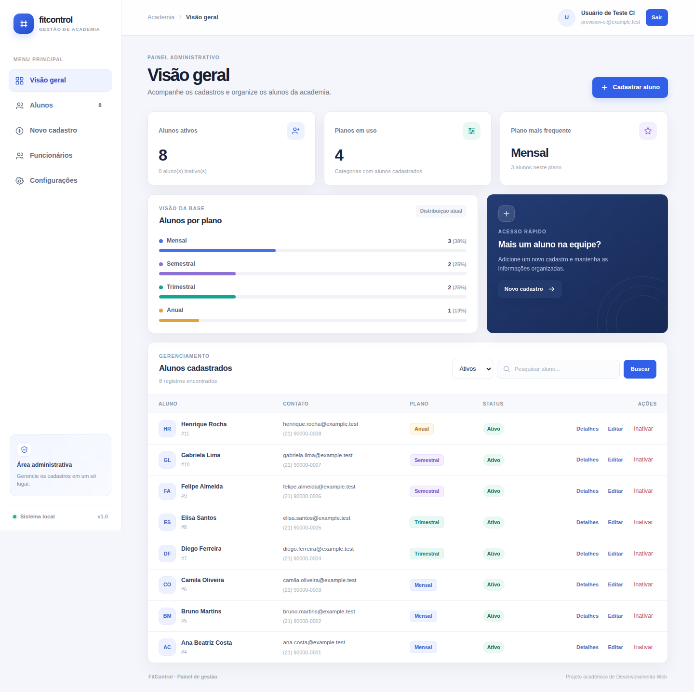
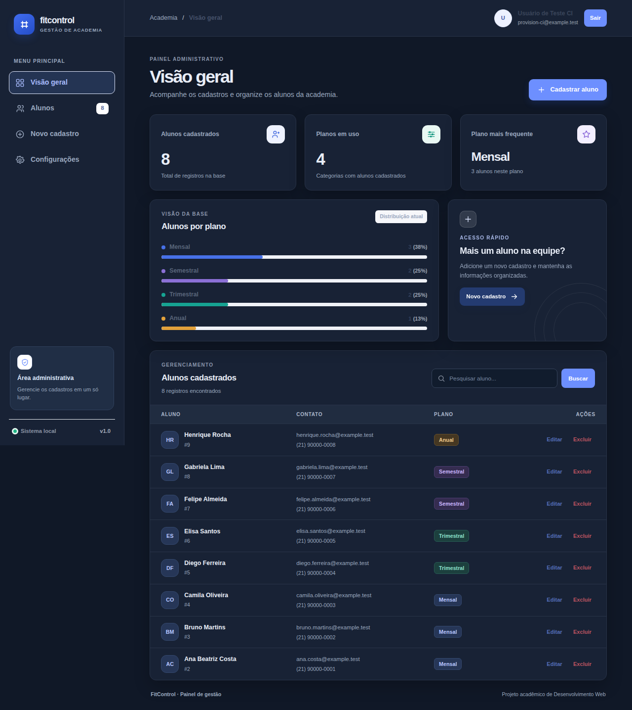
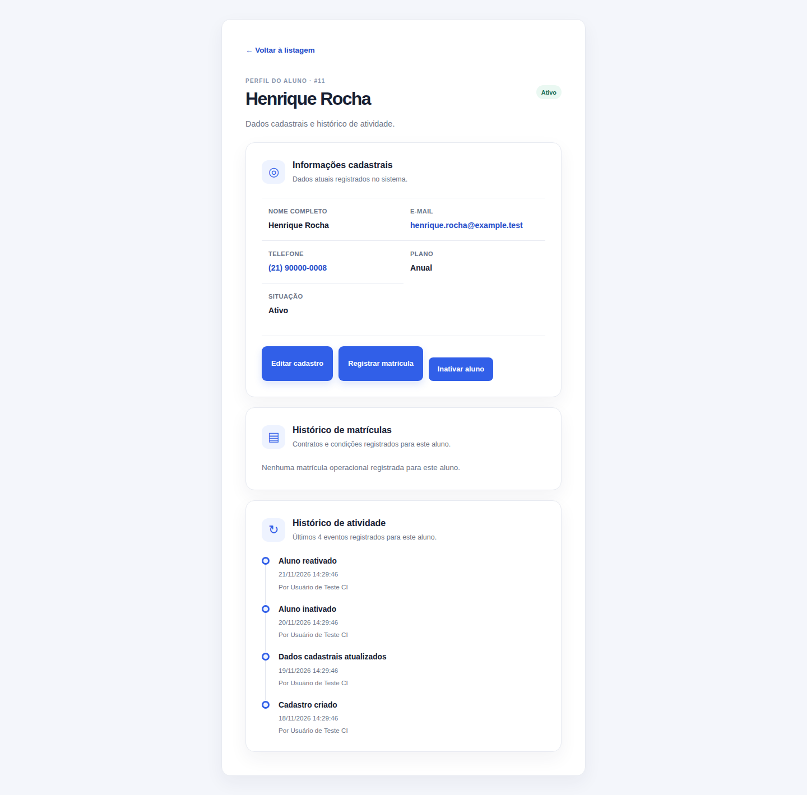
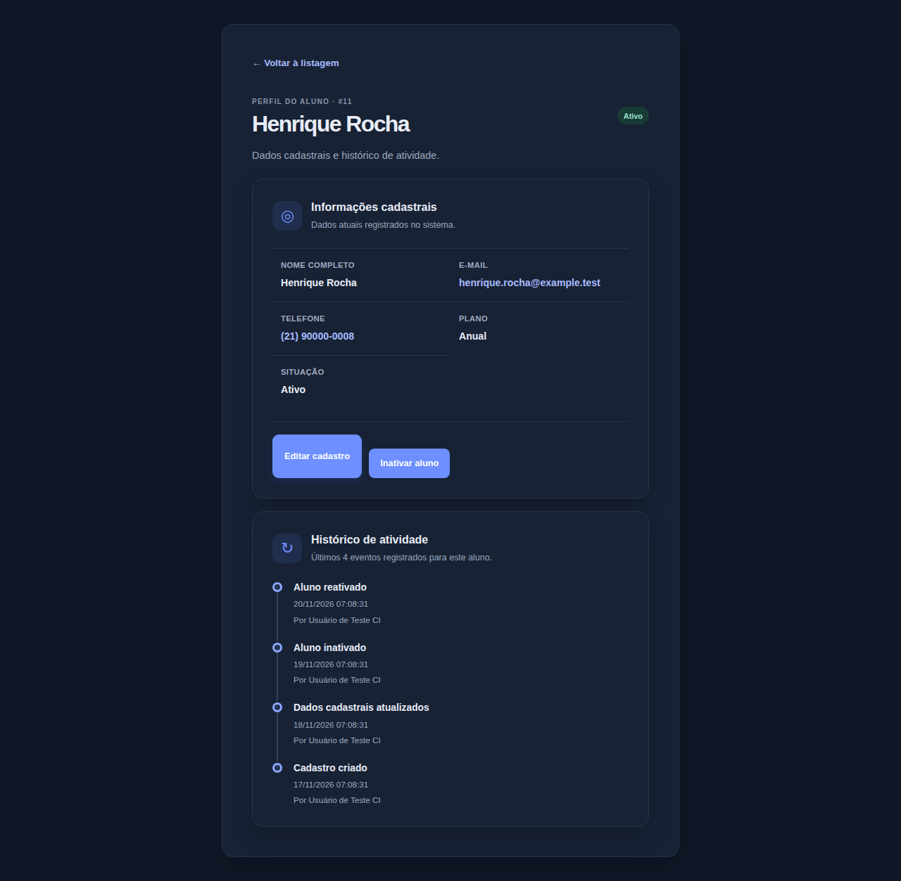

# FitControl — Gestão de alunos de academia

Aplicação acadêmica de Desenvolvimento Web para gerenciar cadastros de alunos de uma academia. O projeto evoluiu de um CRUD em PHP e MySQL para um painel administrativo com indicadores, distribuição de alunos por plano e busca.

## Prévia do projeto

As imagens abaixo são capturadas automaticamente pelo GitHub Actions com registros de demonstração fictícios, preparados apenas no banco efêmero do CI.





### Perfil do aluno — tema claro

<p align="center">
  
  
</p>

### Perfil do aluno — tema escuro

<p align="center">
  
  
</p>

<p align="center">
  
  
  
</p>

<p align="center">
  
</p>

> **Escopo atual:** aplicação acadêmica/local com primeira versão de autenticação individual, gestão de funcionários, auditoria e controle de sessão. Ainda faltam revisão de segurança para produção, HTTPS de produção, monitoramento, backups e controles adicionais. Não exponha o painel à internet nem use dados reais de alunos.

## Bloco 05 — Financeiro (CI validada; validação local pendente)

O módulo cria uma cobrança única pelo contrato, registra pagamentos parciais com transações, idempotência, histórico append-only, auditoria e controle de saldo. O painel separa valores cobráveis de valores em revisão e restringe as operações por RBAC. Os achados F-01 a F-08 foram implementados e validados nas CIs financeiras #1332, #1361, #1362, #1385 e #1397; a CI geral #1420 passou com integração CRUD/Playwright e teste HTTP de bloqueio do perfil Operador. Consulte `docs/bloco-05-financeiro.md` e `docs/revisao-financeira-2026-11-22.md`. O banco local/XAMPP ainda não foi migrado nem testado manualmente; o módulo não deve ser considerado pronto para produção.

## Bloco 06 — Aulas e agenda (CI aprovada; validação local pendente)

O módulo oferece grade semanal fixa, catálogo de modalidades e instrutores, cadastro/edição/inativação de horários, filtros, proteção contra conflitos e auditoria. A CI #1512 aprovou os testes de banco, HTTP e Playwright em Chromium, Firefox e WebKit, incluindo MySQL 8.0 e MariaDB 10.11. A aplicação controlada da migration 014 no XAMPP e a inspeção manual em dispositivo físico continuam pendentes. Consulte `docs/bloco-06-aulas-agenda.md`.

## Bloco 07 — Relatórios e experiência (implementação e CI concluídas; validação manual pendente)

A tela `relatorios.php` apresenta OP-01 a OP-06, MT-01 a MT-05, FR-01 a FR-05 e FN-01 a FN-06, com consultas agregadas, filtro de período e autorização por seção. Os seis cartões VG-01 a VG-06 estão integrados à Visão geral. `exportar-relatorio.php` oferece quatro CSV agregados (operacional, matrículas, frequência e financeiro), com filtros preservados, escaping, neutralização de fórmulas, ausência de PII e RBAC no servidor. As CIs #1595, #45245709878, #45247639018, #45249934923, #45252564979 e #45256688269 aprovaram as consultas, cartões, downloads, primeira bateria de acessibilidade e matriz Chromium/Firefox/WebKit para relatórios em MySQL 8.0/MariaDB 10.11. Permanecem pendentes a abertura manual no Excel/LibreOffice e a inspeção local em XAMPP/dispositivo físico. Não houve migration ou alteração de schema no Bloco 07; a avaliação de índice por `data_pagamento` continua dependente de EXPLAIN com volume representativo. Consulte os documentos do Bloco 07.

## Funcionalidades

- Dashboard com total de alunos cadastrados.
- Indicador de planos em uso e plano mais frequente.
- Distribuição de alunos por plano.
- Cadastro e edição de alunos.
- Listagem com filtro de ativos/inativos/todos e pesquisa por nome, e-mail ou telefone.
- Inativação e reativação lógica de alunos, preservando os registros e a auditoria.
- Perfil individual do aluno com dados cadastrais, situação e histórico simples de auditoria (criação, edição, inativação e reativação).
- Validação dos dados no servidor e no navegador, incluindo formato e quantidade de dígitos do telefone.
- Consultas preparadas com PDO.
- Token CSRF nos formulários de escrita.
- Mensagens de retorno e preservação dos dados após erros de validação.
- Layout responsivo para telas menores.
- Preferência entre tema claro e escuro, disponível em Configurações e salva no navegador.
- Contas individuais de funcionários, provisionadas pelo terminal (sem cadastro público).
- Gestão de funcionários: criação de contas, listagem, desativação e reativação sem apagar o histórico.
- Senhas temporárias aleatórias exibidas uma única vez, com troca obrigatória no primeiro acesso.
- Proteção contra desativar a própria conta e contra deixar o sistema sem contas ativas.
- Auditoria de criação, desativação e reativação de contas, identificando o funcionário responsável.
- Login e logout com senha armazenada por hash, sessão protegida e CSRF.
- Limitação persistente de tentativas: após 5 falhas na combinação de e-mail e origem em uma janela de 15 minutos, o acesso dessa combinação fica bloqueado por 15 minutos.
- Troca obrigatória da senha temporária no primeiro acesso, com mínimo de 12 caracteres.
- Bloqueio das páginas administrativas para visitantes não autenticados e contas desativadas.
- Expiração após 30 minutos sem interação ou 8 horas desde o login, com aviso antecipado e opção de continuar conectado.
- Sincronização autenticada da sessão enquanto o funcionário interage com a página, sem renovar sessões abandonadas.
- Auditoria de login/logout e das operações de cadastro, edição, inativação e reativação de alunos.
- Registro manual de frequência, com check-in diário vinculado à matrícula vigente e ao funcionário responsável.
- Histórico de presenças filtrável por aluno e período, com indicadores de check-ins do dia e do mês.
- Catálogo administrativo de planos, com rascunho, ativação, inativação e proteção de planos vinculados a matrículas.
- Contratação e histórico de matrículas com snapshot de preço/duração, cálculo de vigência, detecção de sobreposição e cancelamento auditado.
- Fila de revisão de vínculos legados, decisões fundamentadas por evidência e histórico append-only.
- Retificação auditada de vigência legada, preservando o intervalo anterior e exigindo nova fonte e justificativa.

> **Estado do Bloco 03 na branch (22/11/2026):** os fluxos de aplicação, migrations 005/006 e testes automatizados estão implementados. As CIs #766 (push) e #767 (PR) passaram integralmente, incluindo execução das migrations em MySQL 8.0 e MariaDB 10.11. O banco local/XAMPP não foi alterado: a aplicação local ainda depende de backup, inspeção da versão e execução manual conforme [guia de migrations para XAMPP](docs/guia-migrations-xampp.md). A PR #1 permanece Draft, `main` intacta e a inspeção em dispositivo físico pendente.

Cada aluno possui nome, telefone, e-mail, plano (Mensal, Trimestral, Semestral ou Anual) e situação ativa/inativa. Registros inativos permanecem consultáveis e editáveis.

## Tecnologias

- PHP 8.2 ou superior, com PDO.
- MySQL 8 ou MariaDB.
- HTML5, CSS3 e JavaScript.
- GitHub Actions para integração contínua.
- Playwright com Chromium, Firefox e WebKit para verificações automatizadas em múltiplos motores de navegador e viewports.
- JavaScript e localStorage para persistência da preferência de tema no navegador.
- Shell script, curl e servidor embutido do PHP para testes de integração.

## Estrutura do projeto

```text
academia-alunos-crud/
├── .htaccess
├── .github/
│   ├── .htaccess
│   └── workflows/ci.yml
├── config/
│   ├── .htaccess
│   └── database.local.example.php
├── database/
│   ├── .htaccess
│   └── migrations/
│   ├── 001_authentication_audit.sql
│   ├── 002_force_password_change.sql
│   ├── 003_login_rate_limit.sql
│   ├── 004_student_status.sql
│   ├── 005_plans_enrollments_schema.sql
│   ├── 006_import_legacy_review.sql
│   ├── 007_administrative_roles.sql
│   ├── 008_audit_integrity_chain.sql
│   ├── 009_attendance_checkins.sql
│   ├── 010_financeiro.sql
│   ├── 011_pagamento_idempotencia.sql
│   ├── 012_pagamentos_append_only.sql
│   ├── 013_financeiro_valores_positivos.sql
│   └── 014_grade_fixa_aulas.sql
├── docs/
│   ├── .htaccess
│   ├── decisoes/
│   ├── bloco-01-autenticacao.md
│   ├── bloco-02-gestao-alunos.md
│   ├── bloco-03-planos-matriculas.md
│   ├── bloco-04-frequencia-checkin.md
│   ├── bloco-06-aulas-agenda.md
│   ├── guia-migrations-xampp.md
│   ├── matriz-permissoes.md
│   ├── roadmap.md
│   └── screenshots/
├── scripts/
│   ├── .htaccess
│   ├── inicializar-integridade-auditoria.php
│   ├── provisionar-usuario.php
│   └── ferramentas de checkpoint e diagnóstico
├── src/
│   ├── .htaccess
│   ├── Domain/Attendance/AttendanceCheckinService.php
│   ├── Domain/Classes/ClassCatalogService.php
│   ├── Domain/Classes/ClassScheduleService.php
│   ├── Domain/Classes/ClassScheduleQuery.php
│   ├── Domain/Enrollment/
│   ├── Domain/Reports/ReportPeriod.php
│   ├── Domain/Reports/OperationalReportQuery.php
│   ├── Domain/Reports/EnrollmentReportQuery.php
│   ├── Domain/Reports/FrequencyReportQuery.php
│   ├── Domain/Reports/FinanceReportQuery.php
│   ├── Infrastructure/DatabaseConfig.php
│   └── Security/
├── tests/
│   ├── .htaccess
│   ├── webroot-protection.sh
│   ├── browser-compatibility.mjs
│   ├── report-period.php
│   ├── database-reports.php
│   ├── database-frequency-reports.php
│   ├── database-finance.php (inclui FN-01 a FN-06)
│   ├── database-attendance-checkin.php
│   ├── database-class-schedule-migration.php
│   ├── database-class-schedule-services.php
│   ├── database-class-schedule-concurrency.php
│   ├── database-class-schedule-query.php
│   ├── integration-crud.sh
│   └── testes de domínio, banco e migrations
├── aulas.php
├── gestao-aulas.php
├── checkins.php
├── registrar-checkin.php
├── login.php
├── index.php
├── relatorios.php
├── detalhes-aluno.php
├── usuarios.php
├── planos.php
├── conexao.php
├── funcoes.php
└── style.css
```

## Como executar localmente com XAMPP

1. Copie ou clone a pasta do projeto em \`C:\\xampp\\htdocs\\academia-alunos-crud\`.
2. Inicie Apache e MySQL no painel do XAMPP.
3. Acesse o phpMyAdmin em [http://localhost/phpmyadmin/](http://localhost/phpmyadmin/).
4. Importe o arquivo \`banco.sql\`. Ele cria o banco \`academia_alunos\` e a tabela \`alunos\`.
5. Copie `config/database.local.example.php` para `config/database.local.php` e confira host, porta, banco, usuário e senha da sua instalação. Esse arquivo local é ignorado pelo Git.
6. No banco \`academia_alunos\`, execute pelo phpMyAdmin (aba SQL), nesta ordem:
   - \`database/migrations/001_authentication_audit.sql\`
   - \`database/migrations/002_force_password_change.sql\`
   - \`database/migrations/003_login_rate_limit.sql\`
   - \`database/migrations/004_student_status.sql\`
7. Antes de habilitar os módulos posteriores, confirme a versão do banco, crie e confira um backup e siga o [guia de migrations para XAMPP](docs/guia-migrations-xampp.md) para aplicar 005–008 na ordem documentada. Não repita migrations DDL já aplicadas.
8. Depois da migration 008 e da inicialização da cadeia de auditoria pelo procedimento do guia, aplique a migration 009 uma única vez: `database/migrations/009_attendance_checkins.sql`. Faça isso somente após backup e inspeção de InnoDB; a CI não aplica migrations no seu computador.
9. Depois de validar a 009, aplique as migrations financeiras 010, 011, 012 e 013, exatamente nessa ordem e conforme as seções 9 a 12 do [guia de migrations para XAMPP](docs/guia-migrations-xampp.md). Faça backup antes; confira os dados existentes antes da 013; não reexecute arquivos DDL já aplicados.
10. No CMD, na raiz do projeto, execute `C:\\xampp\\php\\php.exe scripts\\provisionar-usuario.php`. Informe nome e e-mail e copie a senha temporária exibida: ela aparece uma única vez e não deve ser colocada no repositório.
11. Acesse `http://localhost/academia-alunos-crud/login.php`, entre com o e-mail e a senha temporária e defina sua senha pessoal no primeiro acesso.

### Configuração do banco

Para desenvolvimento local com XAMPP, copie `config/database.local.example.php` para `config/database.local.php`. O exemplo usa `root` sem senha apenas para instalação local; ajuste os valores à sua máquina. O arquivo real é ignorado pelo Git, protegido contra acesso HTTP direto e não deve ser incluído em implantação.

Em qualquer ambiente não local, defina explicitamente `APP_ENV=production` e as cinco variáveis `DB_HOST`, `DB_PORT`, `DB_NAME`, `DB_USER` e `DB_PASSWORD`. Todas são obrigatórias e não podem estar vazias. Sem arquivo local ou variáveis completas, a conexão falha de forma segura; a aplicação não assume mais usuário `root` nem senha vazia.

As variáveis de ambiente têm precedência sobre o arquivo local. Definir `APP_ENV=production` impede que `config/database.local.php` seja carregado. Use um usuário dedicado ao aplicativo, com privilégios mínimos, e mantenha senhas apenas no ambiente ou no gerenciador de secrets do provedor. Consulte [SEC-02 — Configuração do banco e credenciais padrão](docs/seguranca-configuracao-banco.md).
## Frequência e check-in

A página `checkins.php` permite registrar entradas manualmente e consultar o histórico por período e aluno. O servidor aceita check-in apenas para aluno ativo com exatamente uma matrícula vigente, registra o instante em UTC e a data civil no fuso `America/Sao_Paulo`, e impede mais de uma entrada por aluno no mesmo dia. Cada registro identifica a matrícula e o funcionário responsável e gera evento na cadeia de auditoria. QR Code, catraca, registro retroativo e edição/exclusão de presenças não fazem parte deste bloco.

A estrutura é criada pela migration `database/migrations/009_attendance_checkins.sql`, após as migrations 005–008. Antes de aplicar no XAMPP, faça backup, confira versão e InnoDB e siga o procedimento local; não execute a migration em banco com dados reais.

## Testes automatizados

O workflow [CI - Academia Alunos CRUD](https://github.com/Alex5762/academia-alunos-crud/actions/workflows/ci.yml) é executado em pushes para `main` e em eventos de pull request destinados a `main` (incluindo novos commits na branch da PR). O grupo de concorrência cancela execuções obsoletas da mesma PR para priorizar o HEAD mais recente.

O pipeline:

1. prepara PHP 8.2, Node.js 24, MySQL 8 e os motores Chromium, Firefox e WebKit;
2. verifica a sintaxe de todos os arquivos PHP e a presença dos arquivos essenciais;
3. importa `banco.sql`, executa as migrations 001–004 e testa a preservação de alunos existentes;
4. executa um job independente em MySQL 8.0 e MariaDB 10.11, aplica 005/006 e verifica a revisão inicial, preservação byte a byte, ausência de matrículas inventadas e reexecução segura;
5. provisiona uma conta fictícia
6. inicia a aplicação
7. prepara registros fictícios
8. publica as capturas

Antes dos testes HTTP, `tests/migration-student-status.sh` insere um aluno usando o esquema anterior, executa a migração 004 e confere a preservação do ID e dos dados, o status ativo por padrão, o status de novos registros e o índice composto. O teste HTTP cobre também a mudança transacional de status, proteção CSRF, idempotência e aposentadoria da exclusão física.

Os testes de integração cobrem:

- acesso anônimo, login inválido/válido e rejeição de conta desativada;
- troca obrigatória da senha temporária, rejeição da senha antiga e auditoria;
- limite de tentativas de login e liberação após autenticação válida;
- criação, desativação e reativação de funcionários, incluindo bloqueio de autodesativação;
- cadastro, pesquisa, edição, inativação e reativação de alunos, com persistência no MySQL;
- rejeição do endpoint legado `excluir.php` com HTTP 410, sem remover o registro;
- idempotência da alteração de status, sem duplicação de auditoria em solicitações repetidas;
- associação dos eventos de auditoria ao funcionário autenticado;
- logout, revogação de sessão após desativação de conta e proteção CSRF;
- expiração após 30 minutos de inatividade e após 8 horas de duração absoluta;
- renovação autenticada da sessão, rejeição de CSRF inválido e rejeição de método GET.

A captura visual em Chromium verifica a presença dos registros de demonstração, ausência de rolagem horizontal inesperada no desktop/mobile, rolagem interna da tabela no mobile, navegação mobile por teclado, aplicação e persistência do tema escuro, ausência de erros JavaScript e exibição dos avisos de expiração de sessão. O teste `tests/browser-compatibility.mjs` repete verificações essenciais em Chromium, Firefox e WebKit, em larguras desktop, mobile e mobile estreito, incluindo overflow, rolagem interna, navegação por teclado, foco visível, validação nativa dos campos obrigatórios e persistência do tema.

Para conferir os resultados, consulte a aba **Actions** do GitHub. A CI também usa Apache 2.4 para verificar que migrations, scripts, código interno, testes, documentação e metadados Git não são servidos diretamente. Uma execução verde confirma apenas os cenários incluídos no workflow; não substitui inspeção manual no XAMPP, inspeção visual humana em dispositivos e navegadores reais nem uma revisão independente de segurança.

## Documentação

- [Relatório de testes manuais e automatizados](docs/relatorio-testes-academia-alunos.md)
- [Checklist de validação manual pendente — celular real, navegadores e acessibilidade](docs/checklist-validacao-manual.md)
- [Roadmap e critérios de evolução por blocos](docs/roadmap.md)
- [Planejamento do Bloco 01 — autenticação e auditoria](docs/bloco-01-autenticacao.md)
- [SEC-01 — Política de senhas](docs/seguranca-politica-senhas.md)
- [SEC-02 — Configuração do banco e credenciais padrão](docs/seguranca-configuracao-banco.md)
- [SEC-03 — Proteção dos diretórios internos no webroot](docs/seguranca-exposicao-webroot.md)
- [SEC-04 — Sessões, cookies e cabeçalhos HTTP](docs/seguranca-sessoes-cabecalhos.md)
- [SEC-05 — Content Security Policy em modo Report-Only](docs/seguranca-csp.md)
- [Planejamento do Bloco 02 — gestão de alunos](docs/bloco-02-gestao-alunos.md)
- [Pesquisa, implementação e estado do Bloco 03 — planos e matrículas](docs/bloco-03-planos-matriculas.md)
- [Bloco 04 — frequência e check-in](docs/bloco-04-frequencia-checkin.md)
- [Bloco 05 — financeiro](docs/bloco-05-financeiro.md)
- [Bloco 06 — grade fixa de aulas](docs/bloco-06-aulas-agenda.md)
- [Bloco 07 — relatórios e experiência](docs/bloco-07-relatorios-experiencia.md)
- [Bloco 07.1 — catálogo e contrato dos indicadores](docs/bloco-07-catalogo-indicadores.md)
- [Revisão técnica do Bloco 07](docs/revisao-tecnica-bloco-07.md)
- [Revisão técnica do financeiro](docs/revisao-financeira-2026-11-22.md)
- [Procedimento seguro para aplicar migrations 005–013 e validar o XAMPP](docs/guia-migrations-xampp.md)
- [Bloco 05 — financeiro: arquitetura, implementação e validação](docs/bloco-05-financeiro.md)
- [Revisão técnica e achados financeiros F-01 a F-08](docs/revisao-financeira-2026-11-22.md)
- [Roadmap e critérios de evolução por blocos](docs/roadmap.md)
- [Modelo de dados e migração de autenticação/auditoria](docs/modelo-dados-autenticacao-auditoria.md)

### Gestão de funcionários

Depois de entrar com uma conta ativa, abra **Funcionários** no menu lateral. Informe nome e e-mail para criar uma conta; o sistema gera uma senha temporária e a mostra uma única vez na tela. Copie-a e entregue ao funcionário por canal seguro. No primeiro acesso, ele deverá definir uma senha pessoal com pelo menos 12 caracteres.

Na lista, é possível desativar e reativar outras contas. A própria conta não pode ser desativada, e o sistema bloqueia a operação que deixaria a base sem contas ativas. Contas inativas não conseguem entrar; o histórico de auditoria permanece associado à conta. O sistema possui três perfis — Administrador, Gestor e Operador — com permissões diferentes. Consulte a [matriz de permissões](docs/matriz-permissoes.md).

Para alterar sua senha depois do primeiro acesso, abra **Configurações → Segurança da conta → Alterar senha**. O sistema solicita a senha atual, exige uma nova senha com pelo menos 12 caracteres, rejeita a reutilização da senha atual e registra a alteração na auditoria.

## Relação com o material da disciplina

A estrutura PHP partiu do exemplo CRUD de PHP e MySQL do Tutorial 7, adaptando os dados de produtos para alunos. O JavaScript utiliza conceitos básicos de DOM e eventos trabalhados no Tutorial 2.

---

**Projeto:** FitControl — Gestão de alunos de academia  
**Repositório:** [Alex5762/academia-alunos-crud](https://github.com/Alex5762/academia-alunos-crud)


### Limitação de tentativas de login

O login permite até cinco falhas na combinação do e-mail normalizado com o endereço de origem, dentro de uma janela de 15 minutos. A partir da quinta falha, essa combinação fica temporariamente bloqueada por 15 minutos. Um login válido remove o contador correspondente. As mensagens permanecem genéricas para não revelar se uma conta existe.

A migração `database/migrations/003_login_rate_limit.sql` cria a tabela de controle. Ela guarda hashes SHA-256 do e-mail e do endereço de origem, não os valores puros. Esses hashes são dados pseudonimizados, não anônimos; a proteção não substitui HTTPS, monitoramento, controles de borda ou uma política de retenção adequada para produção. O limite é por combinação de e-mail e origem, não um limite global por IP.


### Expiração de sessão

Sessões autenticadas expiram após 30 minutos sem atividade ou após 8 horas desde o login, o que ocorrer primeiro. A atividade renova apenas o prazo de inatividade; ela não reinicia o limite absoluto. Ao expirar, o acesso é encerrado e o funcionário precisa entrar novamente.

## Licença

O código original desenvolvido para o FitControl é disponibilizado sob a licença [MIT](LICENSE). Consulte o arquivo da licença para conhecer as permissões e condições de uso.

A estrutura inicial do projeto foi adaptada a partir do material didático **Tutorial 7 — PHP e MySQL com XAMPP**, disponibilizado pelo professor na disciplina. O material foi utilizado com autorização do professor, e a referência acadêmica permanece registrada neste README. Materiais de terceiros e dependências continuam sujeitos aos respectivos direitos e licenças.
